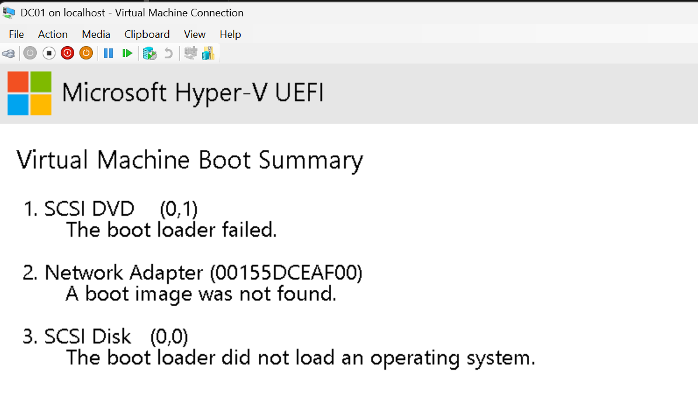

# Day 1: Windows Server 2025 VM on Hyper-V

**Date:** 2026-10-06
**Hardware:** Dell Latitude 5440 (Intel Core i5), Windows 11 Pro
**Goal:** Get Windows Server running in a VM so I can build an Active Directory lab.

## What I did

- Turned on Hyper-V (it's included with Windows 11 Pro but off by default)
- Downloaded the Windows Server 2025 evaluation ISO from Microsoft's Evaluation Center
- Created a Generation 2 VM named DC01 with PowerShell: 2 vCPU, 4 GB static RAM, 60 GB disk, connected to the Default Switch
- Installed Windows Server 2025 Standard Evaluation (Desktop Experience)
- Logged in and got to Server Manager

## What I learned

- Hyper-V only comes with Windows 11 Pro, Enterprise and Education. Home users need VMware Workstation or VirtualBox instead.
- Command Prompt and PowerShell are different shells. If the prompt doesn't start with `PS`, PowerShell commands like `New-Item` won't work.
- `Test-Path` is a quick way to confirm a file actually exists before a script depends on it.
- Gen 2 VMs boot with UEFI and only show the "Press any key to boot from CD or DVD" prompt for a few seconds.
- The default Windows Server option is Server Core with no GUI. You have to pick "Desktop Experience" if you want the desktop.
- Domain controllers should use static memory, so I turned dynamic memory off.

## Risks I found

- **Evaluation license:** it expires in 180 days. I need a plan to rearm it (`slmgr /rearm`) or rebuild before then.
- **Admin password:** I wrote it down during setup. It should go in a password manager instead of staying on paper or in a text file.
- **Network exposure:** the VM is on the Default Switch, so it has internet access through my laptop. That's fine for updates, but anything I attack or test later needs to go on an isolated lab network.
- **Running scripts as admin:** I'm pasting PowerShell into an elevated window. I need to read each command before I run it.

## Issues I ran into

### 1. `New-Item` not recognized

**What happened:** I got `'New-Item' is not recognized as an internal or external command`.
**Cause:** I was in Command Prompt (`C:\Windows\System32>`), not PowerShell.
**Fix:** Typed `powershell` to switch shells. The prompt changed to `PS C:\...` and the command worked. `mkdir C:\ISO` also works in CMD.

### 2. `Test-Path` kept returning False

**What happened:** The script couldn't find `C:\ISO\WindowsServer2025.iso`.
**Cause:** The ISO wasn't saved under that exact name and location.
**Fix:** Used `Get-ChildItem` to find where the file actually was, then moved and renamed it into `C:\ISO`. `Test-Path` returned True after that.

### 3. VM was created but no console window opened

**What happened:** PowerShell showed DC01 with `State: Off` and nothing else happened.
**Cause:** Only part of the pasted script ran. The lines after `New-VM` didn't execute.
**Fix:** Didn't re-run `New-VM` because the VM already existed. Ran the remaining commands on their own (CPU, memory, DVD drive, boot order, `Start-VM`, `vmconnect`).

### 4. "The boot loader failed"

**What happened:** The VM went to the Hyper-V boot summary. The DVD, network adapter and disk all failed to boot.
**Cause:** I missed the "Press any key to boot from CD or DVD" prompt, so it timed out and tried the other devices.
**Fix:** Clicked inside the console, used Action > Reset, and pressed Spacebar repeatedly as soon as the screen went black. Got to Windows Setup.

## Next

- Run Windows Update until it's fully up to date
- Rename the server to DC01
- Take a "Clean install" checkpoint
- Set up an isolated lab network with a static IP and promote DC01 to a domain controller for `lab.internal`
