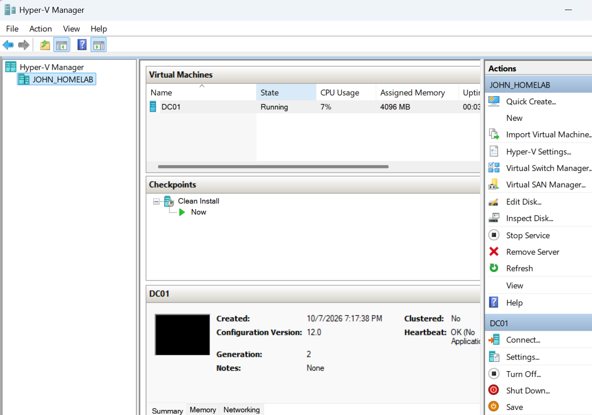
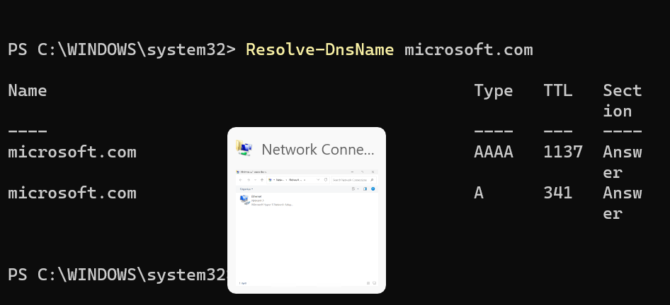
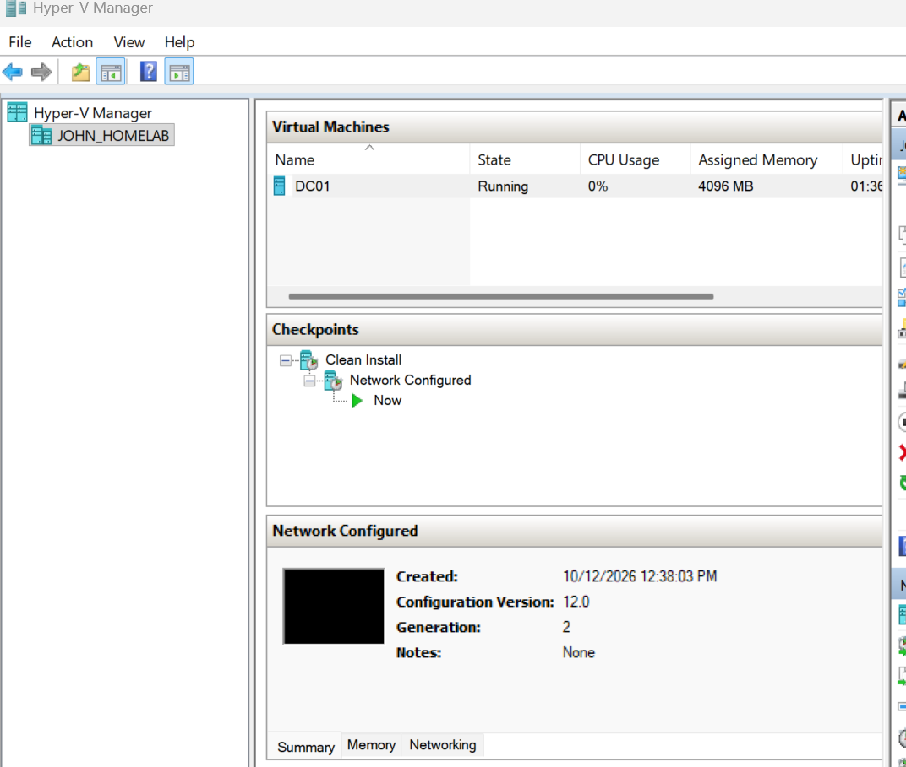
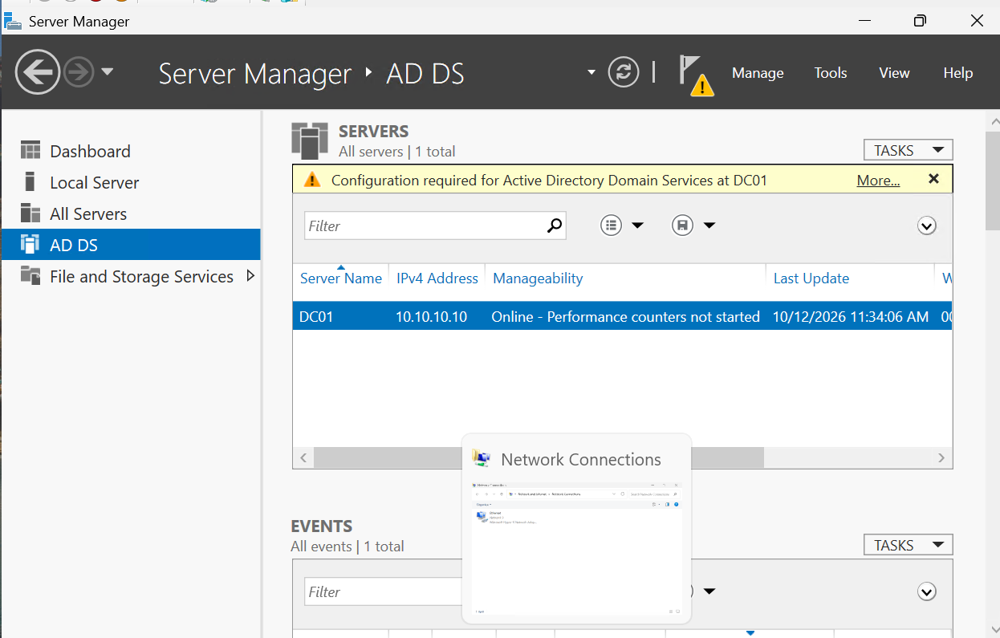
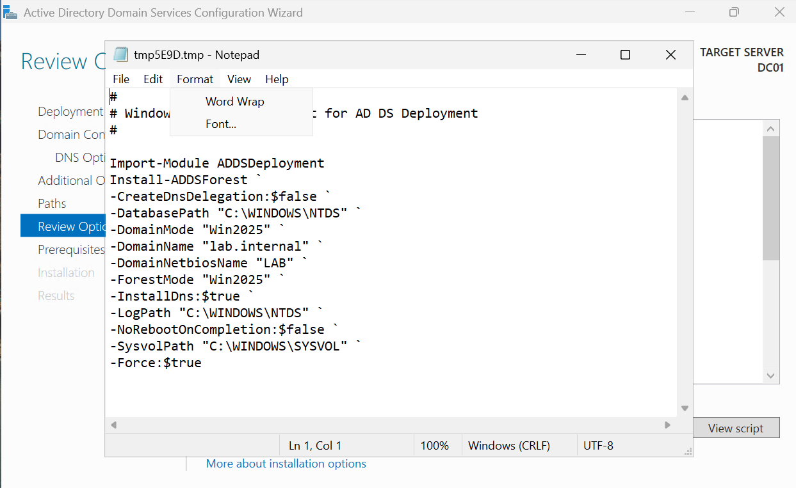
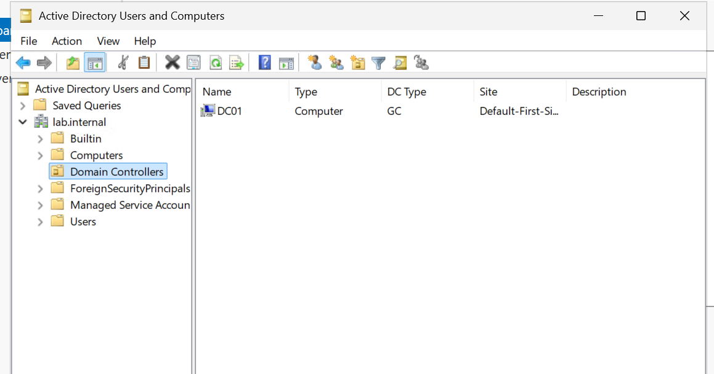
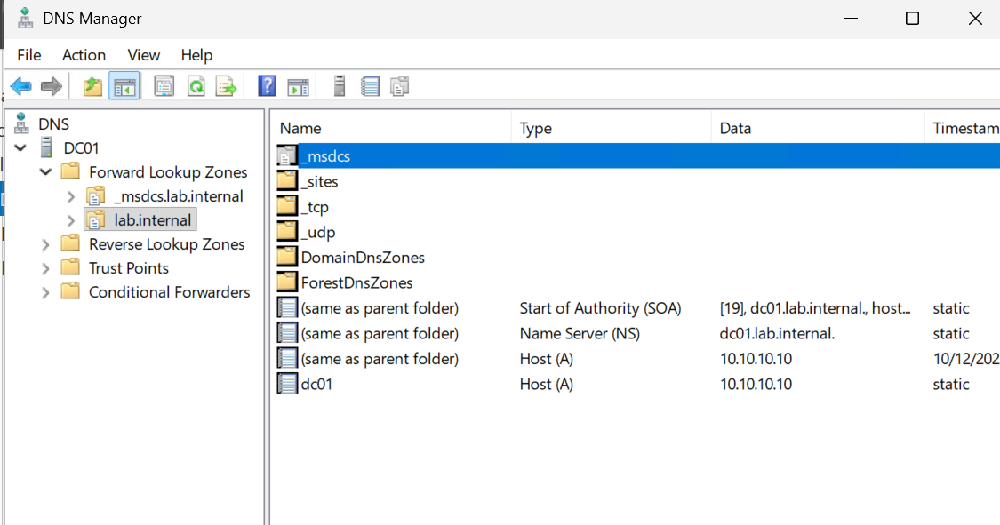
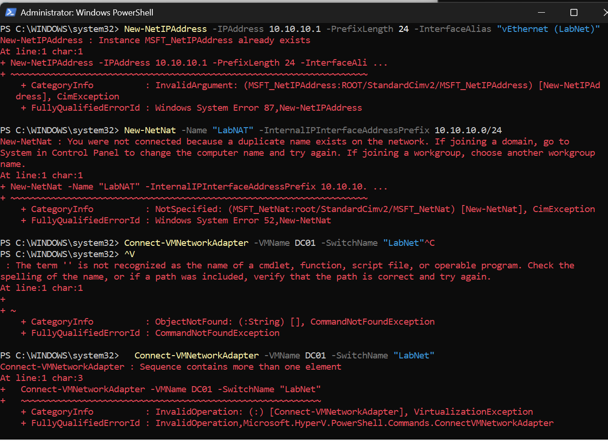
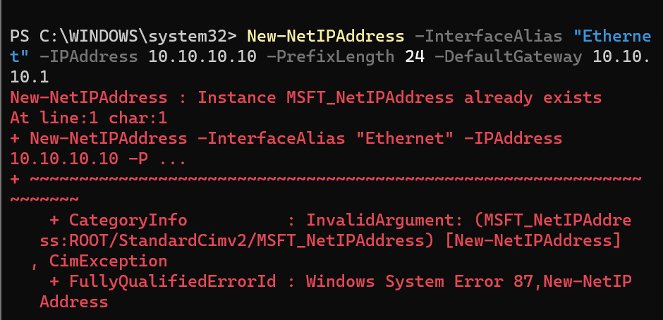

# Day 2: Lab network and first domain controller

**Date:** 2026-10-12
**Time spent:** About 1 to 2 hours
**Goal:** Finish setting up DC01, give it its own lab network, and promote it to the first domain controller for `lab.internal`.

## What I did

- Ran Windows Update inside the VM until it was fully patched
- Renamed the server to DC01 and took a "Clean Install" checkpoint



- Built an isolated lab network on my laptop:
  - Internal Hyper-V switch called **LabNet**
  - Laptop gets **10.10.10.1** on LabNet and acts as the lab's gateway
  - NAT (**LabNAT**) for `10.10.10.0/24` so lab VMs can still reach the internet
- Moved DC01 from the Default Switch to LabNet
- Gave DC01 a static IP: **10.10.10.10/24**, gateway **10.10.10.1**, DNS **1.1.1.1** (temporary, until it became a DC)
- Tested internet and DNS from inside DC01



- Took a "Network Configured" checkpoint



- Installed the Active Directory Domain Services role



- Promoted DC01 to a domain controller in a new forest, **lab.internal** (NetBIOS name **LAB**), with DNS installed on the DC
- Saved the PowerShell the wizard generated with **View script**:



```powershell
Import-Module ADDSDeployment
Install-ADDSForest `
  -CreateDnsDelegation:$false `
  -DatabasePath "C:\WINDOWS\NTDS" `
  -DomainMode "Win2025" `
  -DomainName "lab.internal" `
  -DomainNetbiosName "LAB" `
  -ForestMode "Win2025" `
  -InstallDns:$true `
  -LogPath "C:\WINDOWS\NTDS" `
  -NoRebootOnCompletion:$false `
  -SysvolPath "C:\WINDOWS\SYSVOL" `
  -Force:$true
```

- Verified the domain in Active Directory Users and Computers and DNS Manager
- Took a "DC Promoted" checkpoint





## What I learned

- **Internal switch + NAT** is how you give Hyper-V VMs their own fixed subnet that still has internet. Windows 11 has no GUI for NAT, so `New-NetNat` is PowerShell only.
- Windows keeps IP settings in two places: **ActiveStore** (in use now) and **PersistentStore** (loaded at boot). A new address shows as **Tentative** for a few seconds while Windows checks for duplicates.
- PowerShell's **"Sequence contains more than one element"** means a name matched more than one object. In my case there were multiple switches called LabNet.
- Hyper-V won't delete a switch that a running VM is connected to. Disconnecting the VM's network adapter first fixes that without shutting the VM down.
- Installing the AD DS **role** and **promoting** the server are two separate steps.
- The promotion wizard's **View script** button shows the exact `Install-ADDSForest` command it's about to run. Good for documentation and for learning the PowerShell version.
- The first DC in a forest is automatically a **Global Catalog** and lands in the **Default-First-Site-Name** site.
- The **_msdcs, _sites, _tcp and _udp** folders in DNS hold the SRV records clients use to find a domain controller.
- `dcdiag /q` only prints problems. The **DFSREvent** test looks back 24 hours, so warnings logged during promotion can make it fail even after the problem is gone.
- **Event 4602** means SYSVOL initialized. A DFSR replicated folder **State of 4** means Normal.

## Risks I found

- **Pasting multi-line scripts:** when one line failed, the rest kept running. That's how I ended up with an extra LabNet switch. From now on I run changes one line at a time or use `-ErrorAction Stop`.
- **Wrong machine:** the laptop and the VM both show `PS C:\WINDOWS\system32>`. Running a network command on the laptop instead of DC01 could change my real network adapter. Running `hostname` first takes two seconds.
- **DSRM password:** this is a separate recovery login for AD. If someone gets it, they can get into the directory offline. It needs to go in a password manager, not on paper.
- **Functional level is Windows Server 2025.** Any DC I add later has to run Server 2025 or newer.
- **Checkpoints on a DC:** fine for a single-DC lab, but in a real environment with multiple DCs, rolling back a DC from a snapshot can cause replication problems. Real DC recovery should use proper AD backups.

## Issues I ran into

### 1. Re-running commands gave "already exists" errors

**What happened:** Running the network setup again gave `Instance MSFT_NetIPAddress already exists` and a confusing `duplicate name exists on the network` error from `New-NetNat`.
**Cause:** The IP and the NAT were already created on the first run.
**Fix:** Nothing to fix. Both errors just meant the setting was already there.

### 2. `^V` showed up instead of my command

**What happened:** Pasting with Ctrl+V put a literal `^V` in the console and PowerShell said the term wasn't recognized.
**Fix:** Right-click to paste in that console.

### 3. "Sequence contains more than one element"



**What happened:** `Connect-VMNetworkAdapter -VMName DC01 -SwitchName "LabNet"` failed.
**Cause:** I accidentally ran the PowerShell commands twice, which created a second virtual switch named LabNet.
**Fix:** See issue 4.

### 4. Couldn't delete the extra switches

**What happened:** `Remove-VMSwitch` failed with "cannot be deleted because it is being used by running virtual machines." Because I pasted the whole block, the next line ran anyway and created *another* LabNet.
**Fix:**
1. `Disconnect-VMNetworkAdapter -VMName DC01` to unplug DC01 while it kept running
2. `Get-VMSwitch -Name "LabNet" | Remove-VMSwitch -Force` to delete every LabNet at once
3. Confirmed nothing named LabNet was left
4. Recreated one switch, re-added 10.10.10.1, reconnected DC01, running each command on its own
5. The NAT didn't need to be recreated because it's tied to the subnet, not the switch

### 5. Static IP "already exists" on DC01



**What happened:** `New-NetIPAddress` for 10.10.10.10 failed with "already exists."
**Cause:** I accidentally ran the command twice. The first run had already set the address.
**Fix:** Checked the adapter config instead of forcing it, set DNS to 1.1.1.1, and tested. `Test-NetConnection 1.1.1.1` and `Resolve-DnsName microsoft.com` both worked.

### 6. `dcdiag` failed the DFSREvent test

**What happened:** `dcdiag /q` reported "DC01 failed test DFSREvent" with a warning about SYSVOL replication.
**Investigation:** Checked the DFS Replication event log:

| Time | Event | Meaning |
|---|---|---|
| 11:49:21 | 6016 (Warning) | DFSR couldn't update AD, error 9502 "Bad DNS packet". DNS was still starting during the first boot. |
| 11:49:21 | 4602 | SYSVOL initialized successfully |
| 11:54:22 | 6018 | Retry succeeded five minutes later |

`Get-CimInstance -Namespace "root\MicrosoftDFS" -ClassName DfsrReplicatedFolderInfo` showed the SYSVOL Share in **State 4 (Normal)**.
**Cause:** A one-time timing warning during promotion. DFSR fixed itself on the next retry.
**Fix:** No change needed. The warning ages out of the 24-hour window, so `dcdiag /test:DFSREvent` should pass the next day.

## Next

- Re-run `dcdiag /test:DFSREvent` after 24 hours
- Add a DNS forwarder to 1.1.1.1 on DC01
- Create OUs, users and groups in lab.internal
- Build a Windows 11 client VM and join it to the domain
