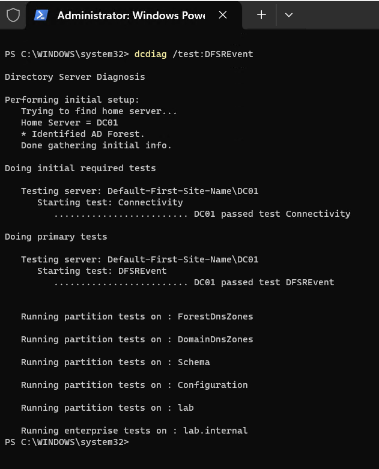
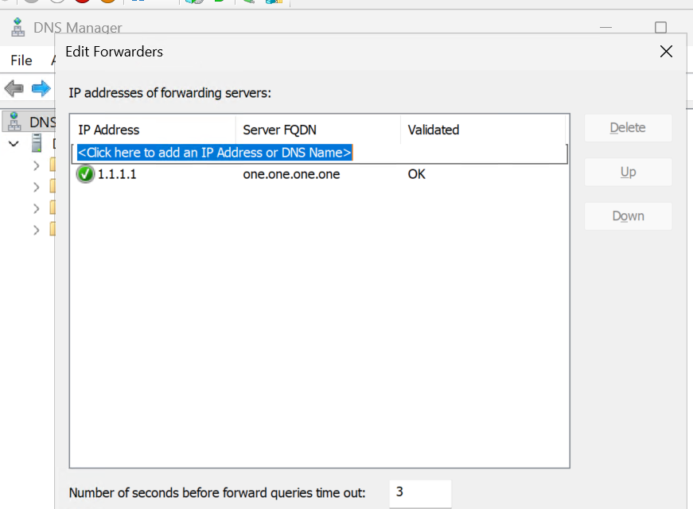
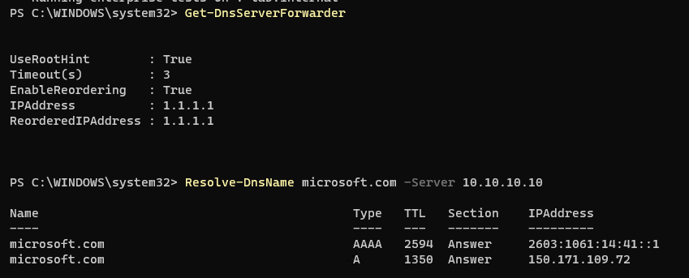
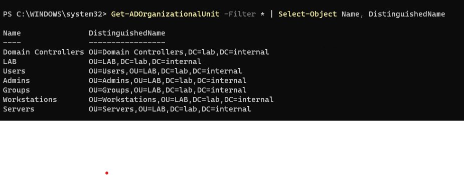
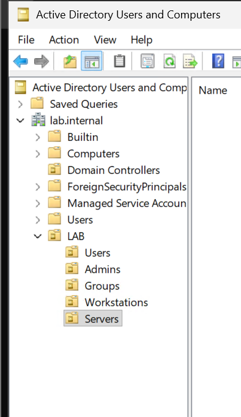
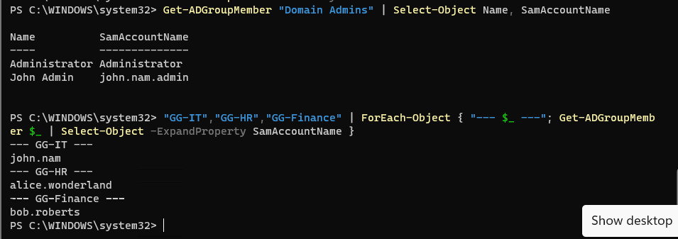
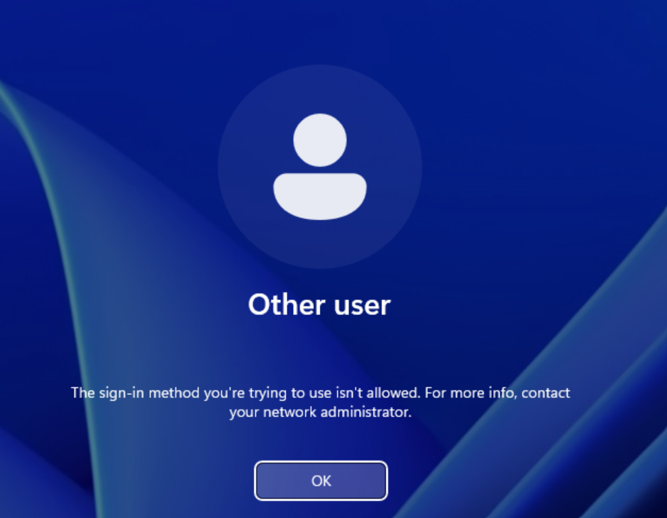
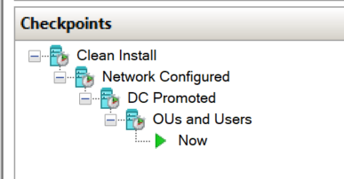
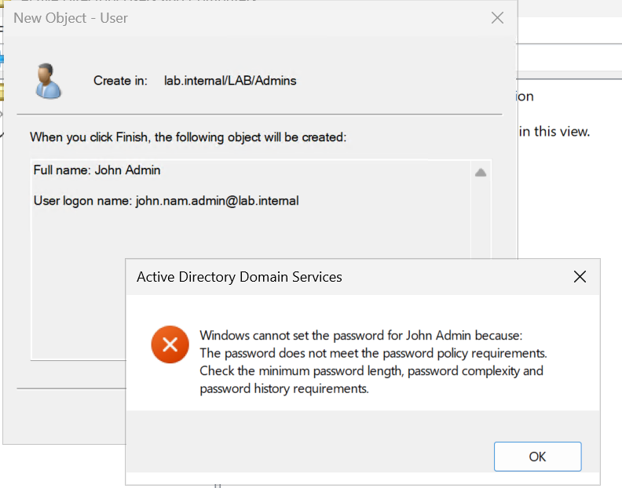
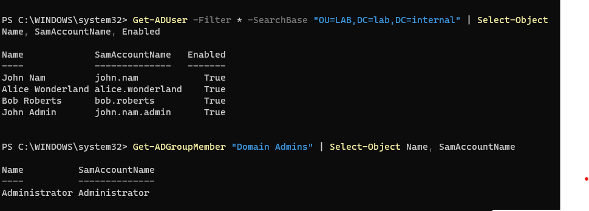

# Day 3: DNS forwarder, OUs, users and groups

**Date:** 2026-10-13
**Time spent:**
**Goal:** Close out yesterday's dcdiag warning, finish DNS setup, and build out the directory with OUs, users, groups and a separate admin account.

## What I did

- Re-ran `dcdiag /test:DFSREvent` after the 24-hour window. It passed, which closes out Day 2's Issue 6.



- Added a DNS forwarder on DC01 to **1.1.1.1** (Cloudflare) and confirmed DC01 resolves internet names itself





- Created an OU structure under a top-level **LAB** OU:

```
lab.internal
└── LAB
    ├── Users
    ├── Admins
    ├── Groups
    ├── Workstations
    └── Servers
```





- Created users and groups:

| Account | OU | Group |
|---|---|---|
| john.nam | LAB/Users | GG-IT |
| alice.wonderland | LAB/Users | GG-HR |
| bob.roberts | LAB/Users | GG-Finance |
| john.nam.admin (John Admin) | LAB/Admins | Domain Admins |



- Tested least privilege: signed in to DC01 as the regular user `LAB\john.nam` and got blocked



- Took an "OUs and Users" checkpoint



## What I learned

- **Forwarders vs root hints:** DC01 answers lab.internal itself and forwards everything else to 1.1.1.1. `UseRootHint: True` means it falls back to the internet's root DNS servers if the forwarder stops responding.
- **OUs vs containers:** the built-in Users and Computers folders are containers, so Group Policy can't be linked to them. Real OUs show a folder icon with a small book in ADUC.
- **DistinguishedName** is how AD addresses every object, read from the object up to the domain: `OU=Users,OU=LAB,DC=lab,DC=internal`.
- **Naming conventions** like the `GG-` prefix (Global Group) make large directories easier to manage.
- **Password complexity is more than length and character types.** The domain policy also rejects passwords that contain the account name or any 3+ character part of the user's full name.
- `Read-Host -AsSecureString` lets you set passwords in PowerShell without them showing up in history or screenshots.
- **Separate admin accounts:** daily work happens as `john.nam`, admin work as `john.nam.admin`. This is least privilege and lines up with NIST 800-171 / CMMC AC.L2-3.1.5 and 3.1.6.
- **Regular users can't sign in to domain controllers.** The "Allow log on locally" right on DCs is limited to admin-type groups through the Default Domain Controllers Policy.

## Risks I found

- **Built-in Administrator is still in use.** It's a well-known account name that attackers target, and using it means admin actions aren't tied to a named person. I'll do admin work as `john.nam.admin` from now on and look at restricting the built-in account later.
- **Domain Admins is the most powerful group in the domain.** Membership should stay as small as possible.
- **"User must change password at next logon" was turned off** for lab convenience. In a real environment it should stay on so admins never know a user's working password.
- **DNS depends on one external forwarder.** Root hints are the fallback, but a second forwarder would add redundancy.
- **16 GB of RAM limits the lab.** The laptop, DC01 and one Windows 11 client fit at about 12 to 14 GB. pfSense and Wazuh will have to wait for a RAM upgrade.

## Issues I ran into

### 1. Password policy rejected the admin account's password



**What happened:** Creating `john.nam.admin` in ADUC failed with "The password does not meet the password policy requirements," even though the password was long enough and had uppercase, lowercase, numbers and a symbol.
**Cause:** The password contained part of the user's full name ("John Admin"). Complexity rules block any 3+ character piece of the account or display name.
**Fix:** Set a password that didn't include "John," "Admin" or "Nam."

### 2. Admin account wasn't actually an admin



**What happened:** All four users were created and enabled, but `Get-ADGroupMember "Domain Admins"` only listed Administrator.
**Cause:** Creating the account doesn't give it any rights. Group membership is a separate step that I hadn't done yet.
**Fix:** `Add-ADGroupMember -Identity "Domain Admins" -Members john.nam.admin`, then re-checked. Both Administrator and John Admin show up now.

**Lesson:** verify, don't assume. The user list looked complete, and the gap only showed up when I checked group membership.

## Next

- Use `john.nam.admin` for admin work instead of the built-in Administrator
- Look at the "Allow log on locally" setting in the Default Domain Controllers Policy
- Build a Windows 11 client VM (4 GB, dynamic memory) and join it to lab.internal
- Sign in to the client as `john.nam` to confirm regular users can use workstations
- Start on Group Policy
