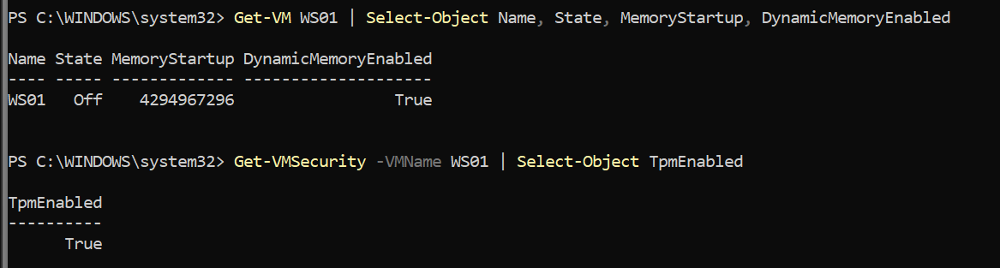
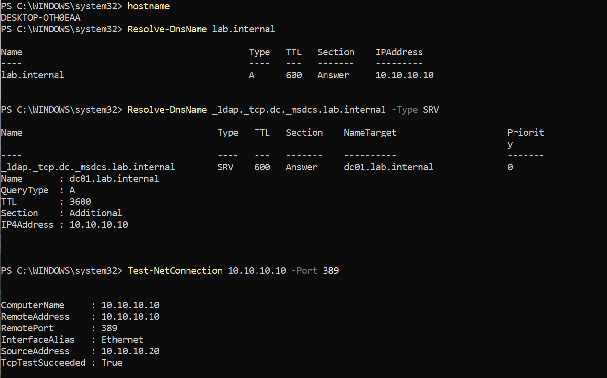
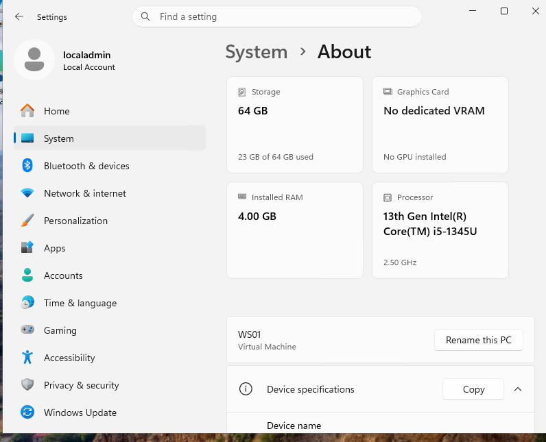
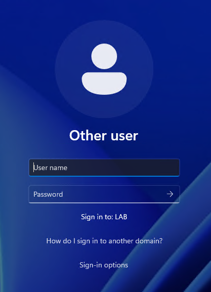
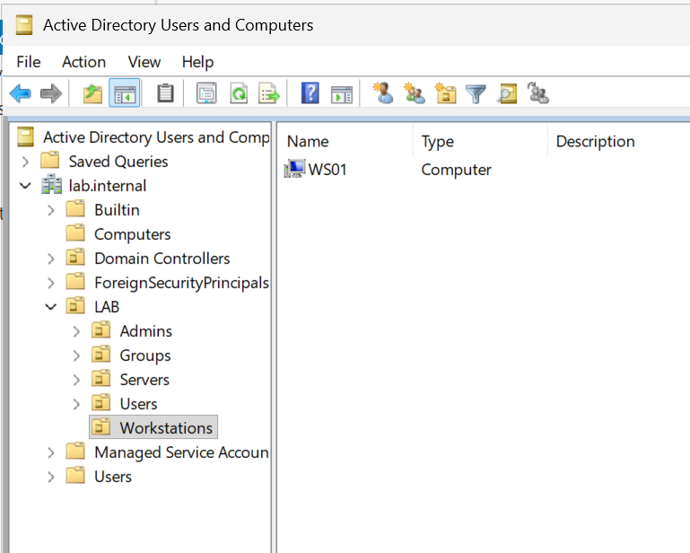
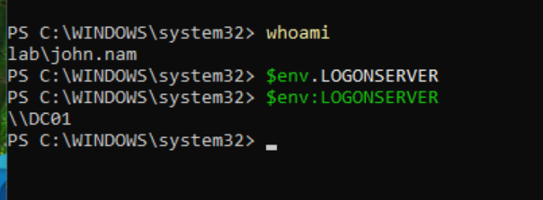
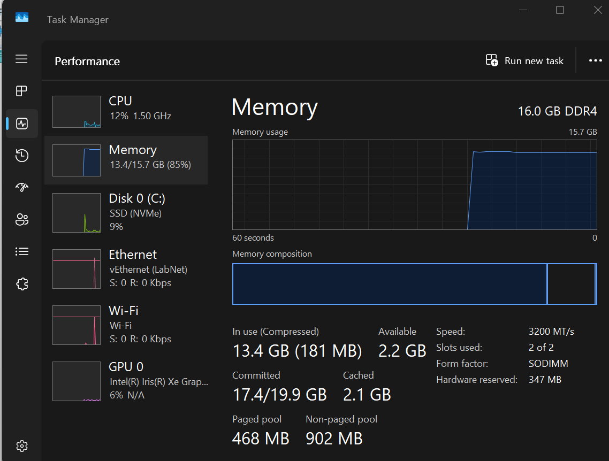
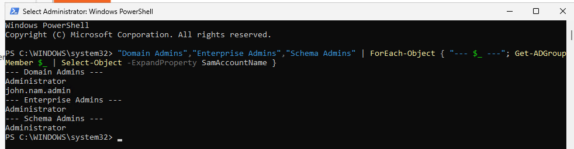
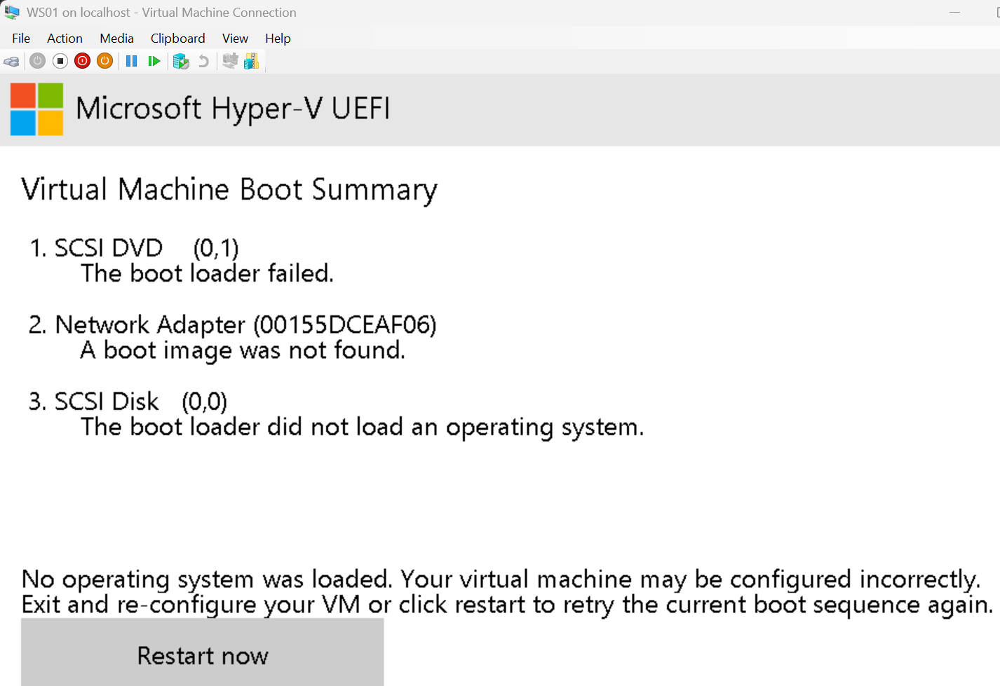
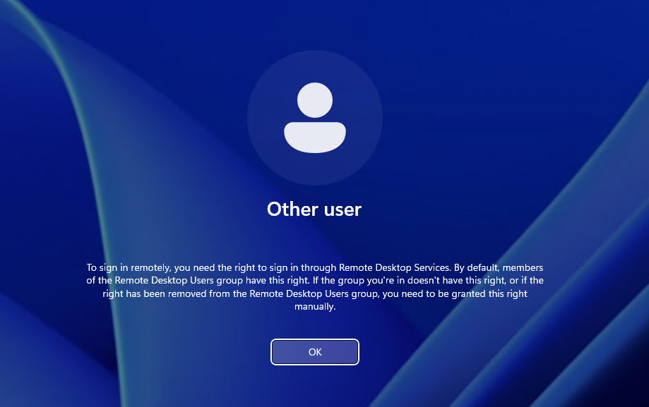

# Day 4: Windows 11 client joined to the domain

**Date:** 2026-10-14
**Time spent:**
**Goal:** Build a Windows 11 client (WS01), join it to lab.internal, and confirm a regular domain user can sign in to a workstation.

Each step lists the manual (GUI) method and the PowerShell equivalent.

## What I did

### 1. Downloaded Windows 11

Downloaded the **Windows 11 Enterprise Evaluation** ISO (90 days) on the laptop, not on DC01, and saved it as `C:\ISO\Win11Enterprise.iso`. Enterprise because Home can't join a domain, and Enterprise allows a local account during setup.

```powershell
Test-Path "C:\ISO\Win11Enterprise.iso"
```

### 2. Created the WS01 VM (on the laptop)

Sized for a 16 GB host: 4 GB startup with dynamic memory between 2 and 4 GB, 2 vCPU, 64 GB disk, connected to LabNet. Windows 11 requires a TPM, so I added a virtual one.

**Manual (Hyper-V Manager):**
1. New > Virtual Machine > name **WS01**, location `C:\HyperV\`
2. Generation 2
3. Startup memory 4096 MB, Use Dynamic Memory checked
4. Connection: **LabNet**
5. New virtual hard disk, 64 GB
6. Install from bootable image: `Win11Enterprise.iso`
7. WS01 > Settings:
   - Security > **Enable Trusted Platform Module**
   - Memory > Minimum 2048 MB, Maximum 4096 MB
   - Processor > 2 virtual processors
   - Checkpoints > uncheck automatic checkpoints

**PowerShell:**
```powershell
New-VM -Name "WS01" -Generation 2 -MemoryStartupBytes 4GB -NewVHDPath "C:\HyperV\WS01\WS01.vhdx" -NewVHDSizeBytes 64GB -SwitchName "LabNet"
Set-VMMemory -VMName "WS01" -DynamicMemoryEnabled $true -MinimumBytes 2GB -StartupBytes 4GB -MaximumBytes 4GB
Set-VMProcessor -VMName "WS01" -Count 2
Set-VMKeyProtector -VMName "WS01" -NewLocalKeyProtector
Enable-VMTPM -VMName "WS01"
Set-VM -VMName "WS01" -AutomaticCheckpointsEnabled $false
Add-VMDvdDrive -VMName "WS01" -Path "C:\ISO\Win11Enterprise.iso"
Set-VMFirmware -VMName "WS01" -FirstBootDevice (Get-VMDvdDrive -VMName "WS01")
```

**Check:**
```powershell
Get-VM WS01 | Select-Object Name, State, MemoryStartup, DynamicMemoryEnabled
Get-VMSecurity -VMName WS01 | Select-Object TpmEnabled
```



`MemoryStartup` is in bytes: 4294967296 = 4 GB.

### 3. Installed Windows 11

```powershell
Start-VM WS01
vmconnect localhost WS01
```

- Pressed Spacebar repeatedly to boot from the ISO
- Install Windows 11 > 64 GB disk > Install
- LabNet has no DHCP, so there was no internet during setup. Chose "I don't have internet" / limited setup and created a local account, **localadmin**.
- Turned off all privacy options

### 4. Static IP with DC01 as DNS (inside WS01)

DNS has to point to **DC01 (10.10.10.10)**, not a public resolver. Clients find the domain by looking up DC01's SRV records.

**Manual:** Settings > Network & internet > Ethernet > IP assignment > Edit > Manual > IPv4 on:
- IP 10.10.10.20, subnet mask 255.255.255.0, gateway 10.10.10.1, preferred DNS 10.10.10.10

**PowerShell:**
```powershell
New-NetIPAddress -InterfaceAlias "Ethernet" -IPAddress 10.10.10.20 -PrefixLength 24 -DefaultGateway 10.10.10.1
Set-DnsClientServerAddress -InterfaceAlias "Ethernet" -ServerAddresses 10.10.10.10
```

**Tests before joining:**
```powershell
Resolve-DnsName lab.internal
Resolve-DnsName _ldap._tcp.dc._msdcs.lab.internal -Type SRV
Test-NetConnection 10.10.10.10 -Port 389
```



- `lab.internal` resolved to 10.10.10.10
- The SRV lookup (the query Windows uses to find a DC) returned `dc01.lab.internal`, with its IP in the Additional section
- LDAP on port 389 succeeded from source 10.10.10.20

### 5. Renamed the computer to WS01

**Manual:** Settings > System > About > Rename this PC > **WS01** > Restart now

**PowerShell:**
```powershell
Rename-Computer -NewName "WS01" -Restart
```



### 6. Joined lab.internal

**Manual:** Settings > Accounts > Access work or school > Connect > "Join this device to a local Active Directory domain" > **lab.internal** > credentials **LAB\john.nam.admin** > Skip account type > Restart now

**PowerShell:**
```powershell
Add-Computer -DomainName "lab.internal" -Credential LAB\john.nam.admin -Restart
```



### 7. Moved WS01 into the Workstations OU (on DC01)

New computers land in the default Computers container, where OU-linked Group Policy doesn't apply.

**Manual:** ADUC > lab.internal > Computers > right-click **WS01** > Move > LAB > Workstations

**PowerShell:**
```powershell
Get-ADComputer WS01 | Move-ADObject -TargetPath "OU=Workstations,OU=LAB,DC=lab,DC=internal"
Get-ADComputer WS01 | Select-Object Name, DistinguishedName
```



### 8. Signed in to WS01 as a regular domain user

Signed in as **LAB\john.nam** using a Basic Session (see Issue 2).

```powershell
whoami
$env:LOGONSERVER
```



Together with Day 3, this shows least privilege working both ways: john.nam is **blocked on the domain controller** but **works normally on a workstation**, authenticated by DC01.

### 9. Checkpoints and host RAM check

- WS01 > **"Domain joined"**
- DC01 > **"WS01 joined"**



## What I learned

- **Windows 11 needs a TPM.** In Hyper-V that means a key protector (`Set-VMKeyProtector`) and then `Enable-VMTPM`.
- **Dynamic memory** lets a VM use between a minimum and maximum, which is how I fit two VMs on 16 GB.
- **DNS is what makes domain join work.** The client has to use the DC for DNS so it can find the `_ldap._tcp.dc._msdcs` SRV record.
- **Test-NetConnection on port 389** is a better check than ping. Ping to the DC can fail because the server firewall blocks it, but LDAP is what actually matters for AD.
- After joining, the sign-in screen says **"Sign in to: LAB"**, so a bare username means a domain account.
- **New computers go to the Computers container**, which isn't an OU. `redircmp` can make new joins land in a real OU automatically.
- **Hyper-V Enhanced Session uses RDP behind the scenes.** Signing in through it counts as a remote sign-in, not a local one.
- **Two different sign-in rights:** "Allow log on locally" (why john.nam is blocked on the DC) and "Allow log on through Remote Desktop Services" (why the Enhanced Session sign-in failed).
- PowerShell environment variables use a colon: `$env:LOGONSERVER`. With a dot, it quietly returns nothing.
- **In use vs committed memory:** "in use" is physical RAM; "committed" includes what Windows has promised and backed with the page file. Committed running close to its limit is the real warning sign.

## Risks

| ID | Risk | L | I | Rating | Controls | Treatment | Status |
|---|---|---|---|---|---|---|---|
| R-012 | Host memory at capacity: 13.4 of 15.7 GB in use (85%), committed 17.4 of 19.9 GB with DC01 and WS01 running. Both RAM slots are full, so an upgrade means replacing both sticks. | 3 | 2 | High (6) | CSF PR.IR-04 | Mitigate | Open |
| R-013 | Granting Remote Desktop rights to a standard user just to get around the Enhanced Session sign-in error | 1 | 2 | Low (2) | 3.1.5, 3.1.12 | Avoid | Closed |
| R-014 | No DHCP, so every IP and DNS setting is manual; one wrong DNS entry breaks domain join | 2 | 1 | Low (2) | 3.4.2 | Mitigate | Open |
| R-015 | Static, manually set local admin password on WS01 (`localadmin`); reused local admin passwords enable lateral movement | 2 | 3 | High (6) | 3.5.10; CIS 5.2 | Mitigate | Open |
| R-001 | Windows 11 Enterprise evaluation expires in 90 days (~2027-01-12), in addition to the Server evaluation | 3 | 1 | Medium (3) | CSF ID.AM-02 | Accept | Accepted |

**Register changes:** new: R-012, R-013, R-014, R-015, R-016, R-017, R-018 / updated: R-001 / closed: R-013

The [Risk Register](../RISK-REGISTER.md) was created today from the Day 1–4 logs. R-016 (no MFA for admins), R-017 (lockout policy not reviewed) and R-018 (no audit logging) came out of that review rather than a specific step.

## Identity and access changes

- **Accounts created:** `WS01\localadmin` (local admin on WS01, created during Windows setup)
- **Computer objects:** WS01 joined lab.internal and moved from the Computers container to LAB/Workstations
- **Group membership changes:** none
- **Privilege changes:** none. Did not add john.nam to Remote Desktop Users (R-013).
- **Sign-in rights tested:** john.nam allowed on WS01 locally, blocked on WS01 over Remote Desktop
- **Access review:** first review of Domain, Enterprise and Schema Admins. All appropriate. Recorded in [Identity and Access](../IDENTITY-AND-ACCESS.md).



## Issues I ran into

### 1. Boot loader failed again



**What happened:** Same as Day 1. WS01 went straight to the Hyper-V boot summary.
**Cause:** Missed the "Press any key to boot from CD or DVD" prompt.
**Fix:** Clicked Restart now and started pressing Spacebar right away. Starting before the prompt appears works every time.

### 2. Regular user couldn't sign in to WS01



**What happened:** Signing in as john.nam said I needed the right to sign in through Remote Desktop Services.
**Cause:** Hyper-V's Enhanced Session Mode connects over RDP, so Windows treated it as a remote sign-in. Regular users aren't in the Remote Desktop Users group. localadmin and domain admins worked because they have that right.
**Fix:** In the VM window, View > unchecked **Enhanced session** to switch to a Basic Session, which is a true local console sign-in. john.nam signed in right away. I didn't add john.nam to Remote Desktop Users, because that would grant remote access just to get around the test.

### 3. `$env.LOGONSERVER` returned nothing

**What happened:** The first try printed nothing and gave no error.
**Cause:** Typed a dot instead of a colon.
**Fix:** `$env:LOGONSERVER` returned `\\DC01`.

## Next

- Optional: `redircmp "OU=Workstations,OU=LAB,DC=lab,DC=internal"` so new computers land in Workstations
- Start Group Policy: password policy, account lockout and audit settings, linked to the LAB OUs
- Test policies on WS01 with `gpupdate /force` and `gpresult /r`
- Look into Windows LAPS for the local admin account
- Plan the RAM upgrade (2x16 GB DDR4-3200 SODIMM)
