# Day 5: Account lockout policy (and a DC that stopped answering)

**Date:** 2026-10-19
**Time spent:**
**Goal:** Close R-017 by configuring an account lockout policy, then prove it works by locking out a test user.

**Result:** Policy configured and verified on DC01. The end-to-end lockout test is **not done yet**, because WS01 and the host can no longer reach DC01 (Issue 6, still open).

## What I did

### 1. Checked the current lockout setting (DC01)

```powershell
Get-ADDefaultDomainPasswordPolicy | Select-Object LockoutThreshold, LockoutDuration, LockoutObservationWindow
```

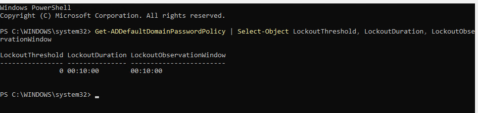

**LockoutThreshold 0** means no lockout at all, so unlimited password guesses were allowed. The 10-minute duration and window did nothing while the threshold was 0.

### 2. Configured lockout in the Default Domain Policy (DC01)

Account policies for domain accounts have to be set in a GPO linked at the domain level, which is the Default Domain Policy.

**Manual:**
1. Server Manager > Tools > **Group Policy Management**
2. Right-click **lab.internal > Default Domain Policy > Edit** (this opens the separate Group Policy Management Editor)
3. Computer Configuration > Policies > Windows Settings > Security Settings > Account Policies > **Account Lockout Policy**
   - Account lockout threshold: **5 invalid logon attempts**
   - Account lockout duration: **15 minutes**
   - Reset account lockout counter after: **15 minutes**

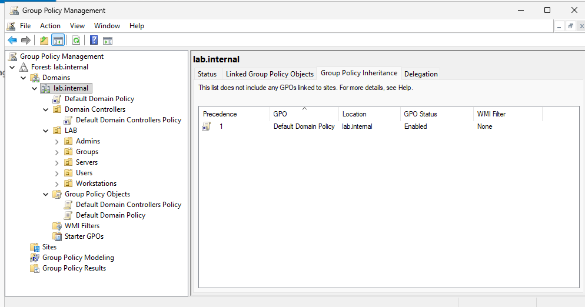

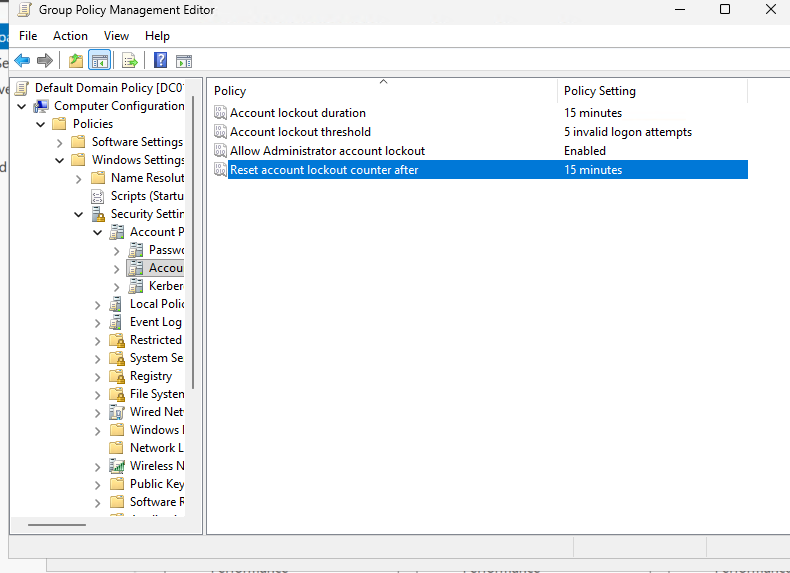

**Allow Administrator account lockout** was already **Enabled**. In older Windows versions the built-in Administrator could never be locked out, which made it a favorite brute-force target.

**Applied and verified:**
```powershell
gpupdate /force
Get-ADDefaultDomainPasswordPolicy | Select-Object LockoutThreshold, LockoutDuration, LockoutObservationWindow
```

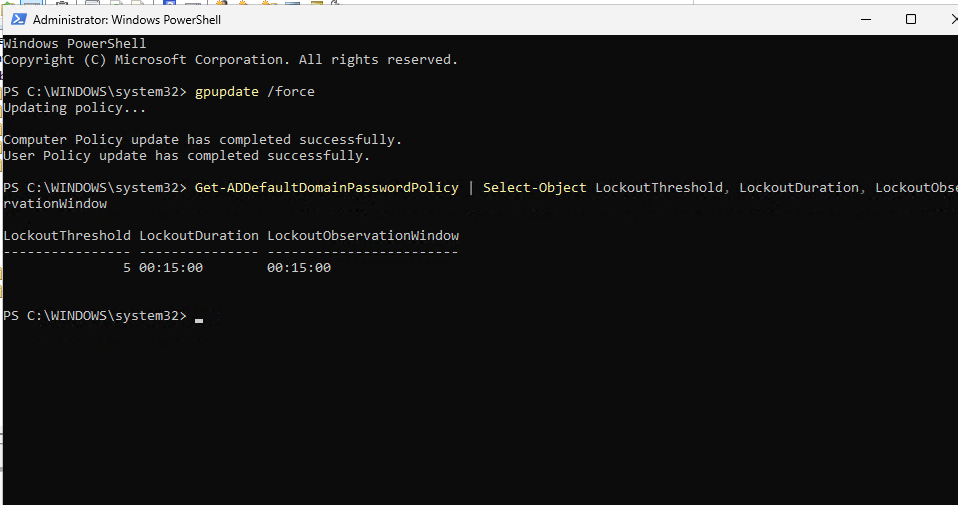

### 3. Tried to test the lockout from WS01

Tried wrong passwords on WS01 to trigger a lockout. That turned into Issues 2 to 6.

### 4. Turned off Enhanced Session Mode on the host

**Manual:** Hyper-V Manager > Hyper-V Settings > User > Enhanced Session Mode > uncheck **Use enhanced session mode**

**PowerShell (laptop):**
```powershell
Set-VMHost -EnableEnhancedSessionMode $false
```

## What I learned

- **Domain account policies** (password and lockout) are set in the **Default Domain Policy**. GPMC only shows the links; **Edit** opens a separate editor where Computer Configuration lives.
- **Lockout threshold 0 = no lockout**, no matter what the other two settings say.
- **Windows caches domain logons.** If a domain-joined PC can't reach a DC, a user who has signed in before can still sign in with the cached copy. Wrong passwords show "Invalid credentials," but the DC never sees them, so they **don't count toward lockout**.
- **"The domain isn't available"** for a user who has *never* signed in to that PC means there's no cached copy and no DC to ask.
- **`BadLogonCount` on the user object** shows whether failed attempts actually reached the DC. 0 meant they never did.
- **`$env:LOGONSERVER` can be misleading.** It showed `\\DC01` from the cached session even though DC01 wasn't reachable.
- **The Remote Desktop rights error appears only after the password is accepted**, so it confirmed my password was right even though sign-in failed.
- **Enhanced Session Mode can come back on its own.** Turning it off in Hyper-V Settings is more reliable than the View menu toggle.
- **Testing from a third point (the host) narrows down a network problem.** If the host and WS01 both fail to reach DC01, the problem is most likely on DC01.

## Risks

| ID | Risk | L | I | Rating | Controls | Treatment | Status |
|---|---|---|---|---|---|---|---|
| R-017 | Account lockout policy not configured | 2 | 2 | Medium (4) | 3.1.8 | Mitigate | **In progress**: configured and verified; end-to-end test pending |
| R-002 | Passwords not stored in a password manager. **Happened today:** couldn't remember the localadmin password and wasn't sure of john.nam's. | **3** | 3 | **High (9)** | 3.5.10 | Mitigate | Open |
| R-015 | Static local admin password on WS01. **Happened today:** forgotten, with no way to look it up. Windows LAPS would store it in AD. | 2 | 3 | High (6) | 3.5.10; CIS 5.2 | Mitigate | Open |
| R-008 | Built-in Administrator in use | 2 | 3 | High (6) | 3.3.2, 3.5.1; CIS 4.7, 5.4 | Mitigate | In progress: "Allow Administrator account lockout" confirmed enabled |
| **R-020** | Cached domain logons let previous users sign in when no DC is reachable; failed attempts against the cache don't count toward lockout | 2 | 2 | Medium (4) | 3.5.2, 3.1.8 | Accept | Accepted: needed for offline laptops; review cache count via GPO later |
| **R-021** | DC01 unreachable from WS01 and the host on LDAP (389). Domain sign-ins fail, and nothing alerted me. | 3 | 2 | **High (6)** | 800-53 SI-4; CSF DE.CM | Mitigate | Open: troubleshooting |

**Register changes:** new: R-020, R-021 / updated: R-002 (score 6 to 9), R-008, R-015, R-017

## Identity and access changes

- **Policy change:** Default Domain Policy lockout set to 5 attempts / 15 minutes / 15 minutes (was threshold 0)
- **Built-in Administrator:** lockout applies to it (setting confirmed enabled)
- **Credentials:** `WS01\localadmin` password lost and not recoverable without LAPS or a reset by a domain admin
- **Accounts, groups, privileges:** no changes
- **Host change:** Enhanced Session Mode disabled, so VM sign-ins are true local console logons

## Issues I ran into

### 1. Couldn't find Computer Configuration


**What happened:** In Group Policy Management, there was no Computer Configuration anywhere.
**Cause:** GPMC is for managing GPO links. Settings are edited in a separate window.
**Fix:** Right-click **Default Domain Policy > Edit** to open the Group Policy Management Editor.

### 2. "The domain isn't available" for bob.roberts

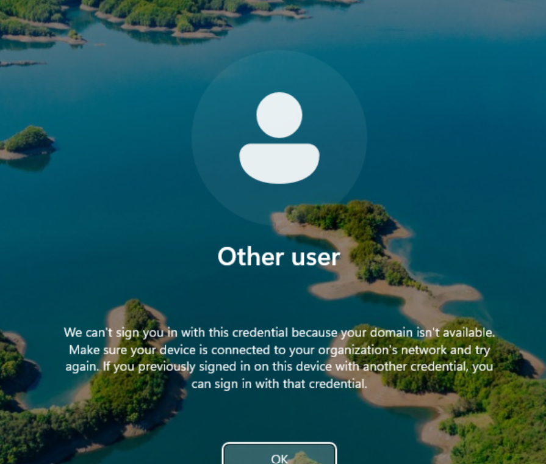

**What happened:** bob.roberts couldn't sign in to WS01 at all.
**Cause:** WS01 couldn't reach DC01 (Issue 6), and bob.roberts had never signed in to WS01, so there was no cached logon to fall back on.

### 3. Wrong passwords never locked out john.nam

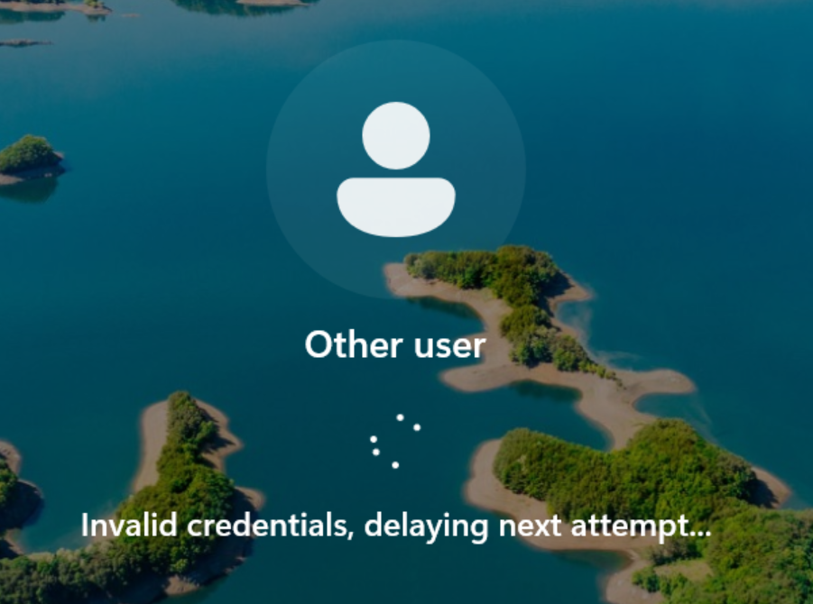

**What happened:** Switched to john.nam. Every wrong password said "Invalid credentials, delaying next attempt," but the account never locked.
**Investigation (DC01):**
```powershell
Get-ADUser john.nam -Properties BadLogonCount, LockedOut | Select-Object BadLogonCount, LockedOut
```

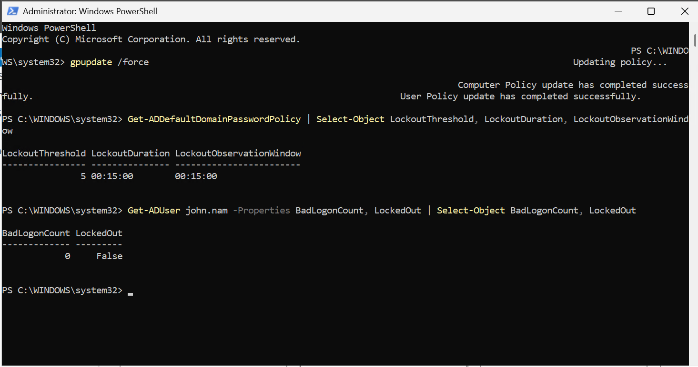

**Cause:** **BadLogonCount 0** proved DC01 never received the attempts. WS01 was checking passwords against john.nam's **cached logon** from Day 4 (R-020).
**Lesson:** I first read "Invalid credentials" as proof that WS01 reached the DC. Checking the DC's own counter showed otherwise.

### 4. Forgot the localadmin password

**What happened:** Needed a local sign-in on WS01 to troubleshoot, but couldn't remember the `localadmin` password, and wasn't sure of john.nam's either.
**Fix:** john.nam's password turned out to be correct (Issue 5 proved it). localadmin is still unknown and will need a reset by a domain admin once WS01 can reach DC01 again, or Windows LAPS.
**Lesson:** this is R-002 and R-015 happening for real, not just in theory.

### 5. Remote Desktop rights error again

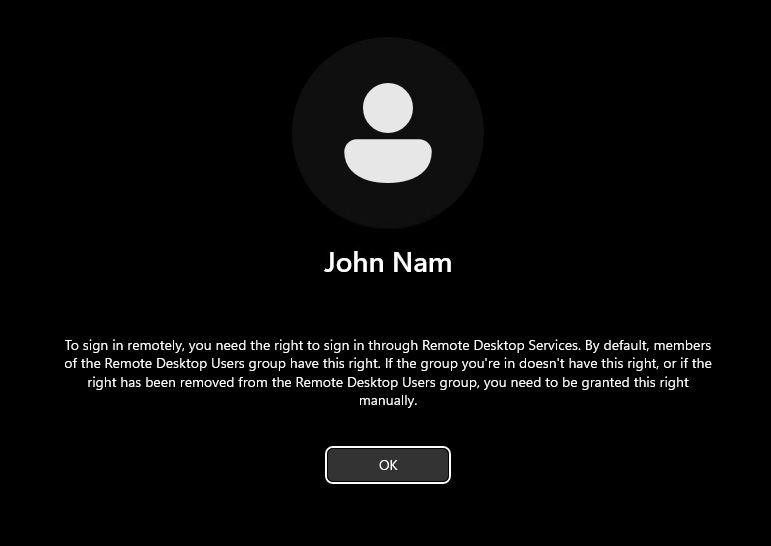

**What happened:** Same error as Day 4 when signing in as john.nam.
**Cause:** The WS01 window had gone back to **Enhanced Session**, which signs in over RDP. Unchecking it in the View menu didn't stick.
**Fix:** Turned off Enhanced Session Mode for the whole host in **Hyper-V Settings** (or `Set-VMHost -EnableEnhancedSessionMode $false`), closed and reopened the WS01 window, then signed in as john.nam. Still didn't grant RDP rights (R-013).

### 6. DC01 not reachable on LDAP (OPEN)

**What happened:** From WS01:
```powershell
Test-NetConnection 10.10.10.10 -Port 389
```

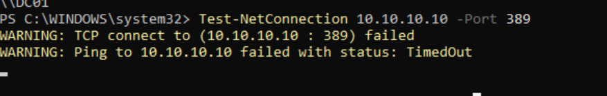

**What I checked:**

| Check | Where | Result |
|---|---|---|
| VM network adapters | Laptop: `Get-VMNetworkAdapter -VMName WS01, DC01` | Both on LabNet, status Ok |
| WS01 IP config | WS01: `ipconfig` | 10.10.10.20 / 255.255.255.0, gateway 10.10.10.1 (correct) |
| LDAP from the host | Laptop: `Test-NetConnection 10.10.10.10 -Port 389` | **Failed** |
| DC01 IP config | DC01: `ipconfig` | 10.10.10.10 / 255.255.255.0, gateway 10.10.10.1 (correct) |
| DC01 firewall profile | DC01: `Get-NetConnectionProfile` | DomainAuthenticated (correct) |

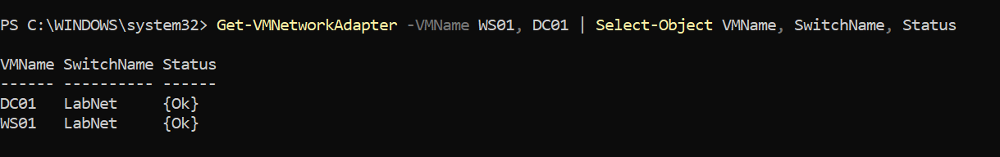

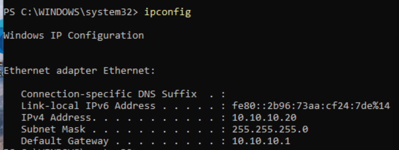

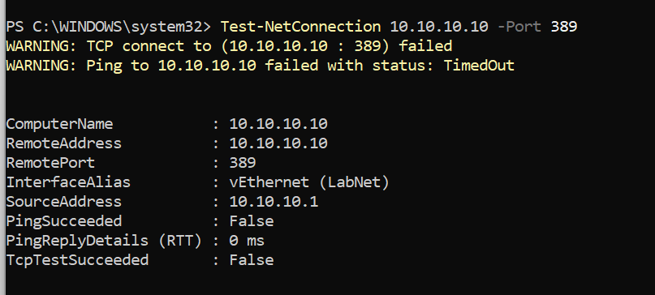

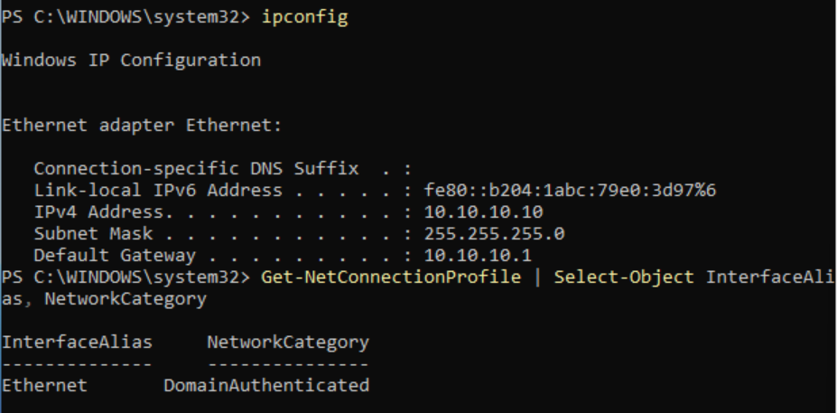

**What this tells me so far:** cabling, IPs and DC01's firewall profile are all correct, but **two different machines** can't reach DC01. The problem is most likely on DC01: either AD isn't listening on 389, or something on DC01 is blocking incoming traffic.

**Next checks (DC01):**
```powershell
Get-Service NTDS, DNS, Netlogon | Select-Object Name, Status
Test-NetConnection 10.10.10.10 -Port 389
Test-NetConnection 1.1.1.1
Get-NetFirewallProfile | Select-Object Name, Enabled, DefaultInboundAction
```

## Next

- Finish troubleshooting Issue 6 / R-021 with the DC01 checks above
- Re-run the lockout test with bob.roberts, confirm with `Search-ADAccount -LockedOut` and Event 4740, then unlock
- Reset the WS01 `localadmin` password and store all lab passwords in a password manager (R-002)
- Plan Windows LAPS (R-015)
