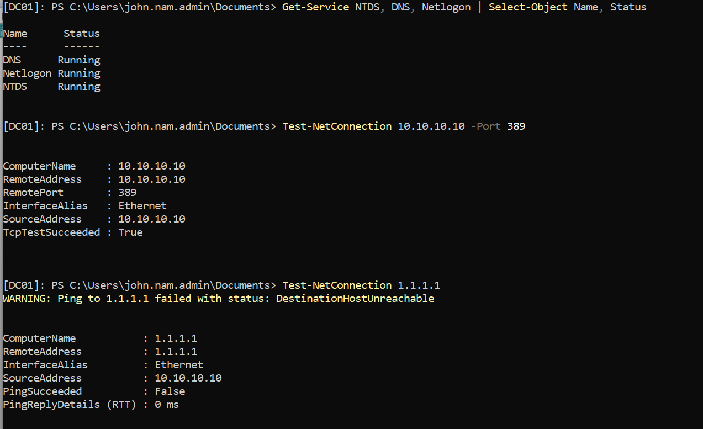
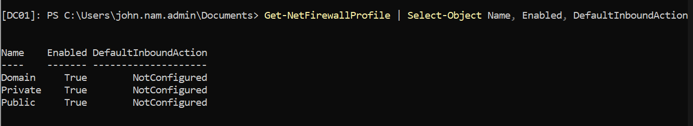
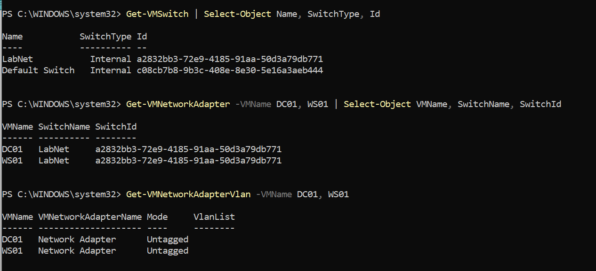
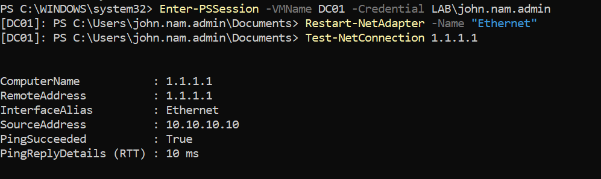
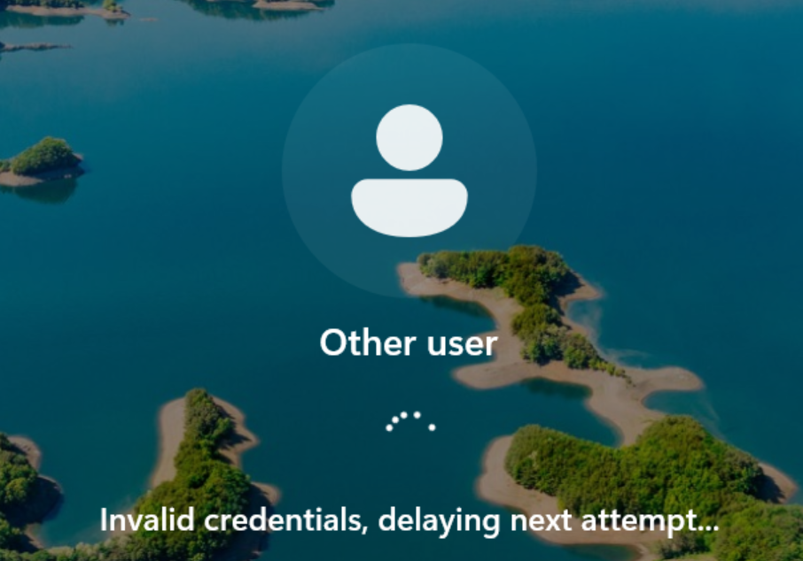
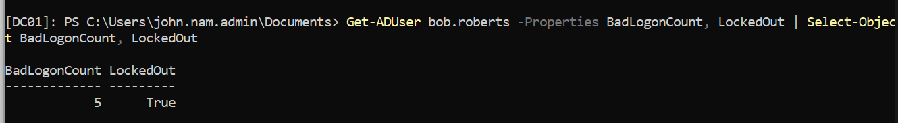
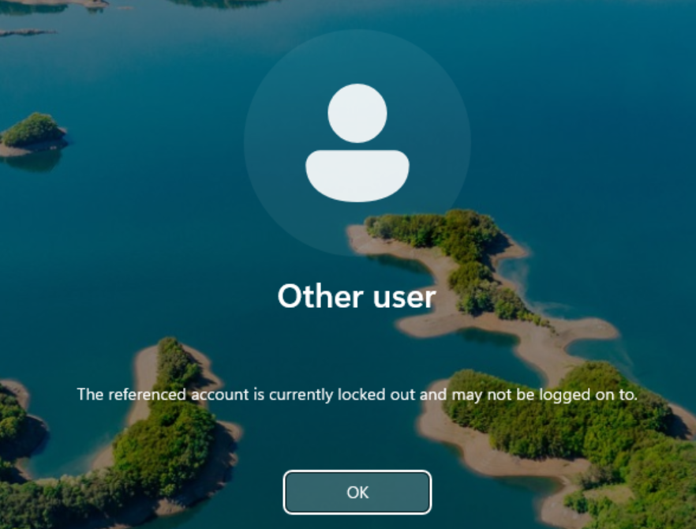
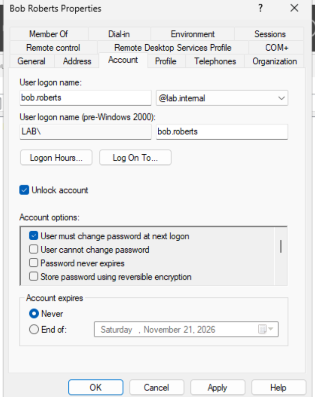

# Day 6: Fixing DC01 connectivity and testing the lockout policy

**Date:** 2026-10-22
**Time spent:**
**Goal:** Find out why WS01 and the host couldn't reach DC01 (R-021), then finish the end-to-end lockout test (R-017).

**Result:** Both done. DC01's virtual network adapter was stuck and a restart fixed it. bob.roberts locked out after 5 bad passwords and stayed locked even with the correct password.

## What I did

### 1. Got a working shell on DC01 with PowerShell Direct

Enhanced Session Mode was turned off on Day 5, so the Basic Session console has no copy and paste. Two ways around it:

**Manual:** in the VM window, Clipboard > **Type clipboard text** types whatever is on the laptop's clipboard into the VM.

**PowerShell Direct (laptop):**
```powershell
Enter-PSSession -VMName DC01 -Credential LAB\john.nam.admin
```

The prompt changes to `[DC01]: PS ...>` and commands run on DC01 with normal copy and paste. PowerShell Direct goes through Hyper-V's VMBus, not the network, so it worked even though DC01's network was down. `exit` ends the session.

### 2. Checked DC01 itself

```powershell
Get-Service NTDS, DNS, Netlogon | Select-Object Name, Status
Test-NetConnection 10.10.10.10 -Port 389
Test-NetConnection 1.1.1.1
Get-NetFirewallProfile | Select-Object Name, Enabled, DefaultInboundAction
```





| Check | Result | Meaning |
|---|---|---|
| NTDS, DNS, Netlogon | Running | AD is fine |
| LDAP 389 from DC01 to itself | True | AD is listening |
| DC01 to 1.1.1.1 | **DestinationHostUnreachable** | DC01 can't even reach its gateway |
| Firewall profiles | Enabled, NotConfigured | Normal defaults |

"Destination host unreachable" means DC01 got no answer from the gateway at all. That's a connection problem, not a firewall block.

### 3. Ruled out a duplicate switch or VLAN mismatch (laptop)

```powershell
Get-VMSwitch | Select-Object Name, SwitchType, Id
Get-VMNetworkAdapter -VMName DC01, WS01 | Select-Object VMName, SwitchName, SwitchId
Get-VMNetworkAdapterVlan -VMName DC01, WS01
```



One LabNet switch, the same SwitchId for DC01 and WS01, and no VLAN tags. The configuration was correct, which pointed to the adapter itself.

### 4. Restarted DC01's network adapter (the fix)

**Manual:** inside DC01, Network Connections (`ncpa.cpl`) > right-click **Ethernet** > Disable, then Enable.

**PowerShell (DC01, through PowerShell Direct):**
```powershell
Restart-NetAdapter -Name "Ethernet"
Test-NetConnection 1.1.1.1
```



### 5. Tested the lockout policy end to end

Signed in to WS01 as **bob.roberts** with the wrong password five times. bob.roberts has never signed in to WS01, so there's no cached logon. Every attempt had to go to DC01.



**Checked on DC01:**
```powershell
Get-ADUser bob.roberts -Properties BadLogonCount, LockedOut | Select-Object BadLogonCount, LockedOut
```



The fifth bad password triggered the lockout, but WS01 still showed "invalid credentials" for that attempt. The **next** attempt, with the **correct** password, was rejected:



This also confirms that WS01 to DC01 connectivity was fully restored, since DC01 counted every attempt.

### 6. Unlocked the account

**Manual:** ADUC > LAB > Users > **Bob Roberts** > Properties > **Account** tab > check **Unlock account** > OK



**PowerShell (DC01):**
```powershell
Unlock-ADAccount -Identity bob.roberts
Get-ADUser bob.roberts -Properties LockedOut | Select-Object LockedOut
```

Without an admin unlock, the account would unlock on its own after the 15-minute lockout duration.

### 7. Lined up account settings with the risk register

The Account tab showed **"User must change password at next logon" checked** for bob.roberts, even though the register (R-010) said lab users were created without it. I unchecked it for **bob.roberts** and **alice.wonderland** as a deliberate lab-convenience choice, so the accounts now match the accepted risk.

**PowerShell check for every lab user:**
```powershell
Get-ADUser -Filter * -SearchBase "OU=LAB,DC=lab,DC=internal" -Properties pwdLastSet | Select-Object SamAccountName, @{n='MustChange';e={$_.pwdLastSet -eq 0}}
```

## What I learned

- **PowerShell Direct** (`Enter-PSSession -VMName`) gives a remote shell into a VM through Hyper-V itself, without needing the VM's network. It's the right tool when the network is what's broken.
- **Clipboard > Type clipboard text** works in a Basic Session when paste doesn't.
- **"Destination host unreachable" vs "timed out":** unreachable means nothing on the local network answered at all, which points to a connection or adapter problem rather than a firewall.
- **Correct configuration doesn't mean working.** The switch, IPs, VLANs and firewall profile were all right, but the adapter was stuck. A laptop sleeping with VMs running is a common cause.
- **Rule things out in layers:** services, then the local port, then the gateway, then the virtual switch, then the adapter. Each check removed a whole category of possible causes.
- **The lockout message shows up on the attempt after the lockout.** The attempt that triggers it still says "invalid credentials."
- **A locked account is rejected even with the correct password.** That's the real proof the control works.
- **`BadLogonCount` on the DC** is the reliable way to confirm attempts are reaching the domain, especially after Day 5's cached-logon confusion.
- **What ADUC shows can differ from what I documented.** Checking the account directly caught the R-010 mismatch.

## Risks

| ID | Risk | L | I | Rating | Controls | Treatment | Status |
|---|---|---|---|---|---|---|---|
| R-021 | DC01 unreachable on LDAP from WS01 and the host | 3 | 2 | High (6) | 800-53 SI-4; CSF DE.CM | Mitigate | **Closed**: stuck adapter, fixed with `Restart-NetAdapter` |
| R-017 | Account lockout policy was threshold 0 | 2 | 2 | Medium (4) | 3.1.8 | Mitigate | **Closed**: 5 / 15 min / 15 min, tested end to end |
| R-010 | Lab users without "must change password at next logon" | 2 | 2 | Medium (4) | 3.5.9 | Accept | Accepted, **corrected**: bob.roberts actually had it on; now deliberately off for bob.roberts and alice.wonderland |
| **R-022** | Laptop sleep or hibernate with VMs running can leave virtual network adapters stuck, silently cutting off the DC | 2 | 2 | Medium (4) | CSF PR.IR-03 | Mitigate | Mitigated (procedural): shut down or save VMs before sleep |
| **R-023** | Whoever controls the Hyper-V host controls DC01 (console, PowerShell Direct, virtual disks). The host is my everyday laptop. | 2 | 3 | High (6) | 3.1.5; 800-53 AC-6 | Accept | Accepted for the lab; in production, a host running DCs should be treated as a Tier 0 asset |
| R-018 | No centralized audit logging or alerting | 3 | 2 | High (6) | 3.3.1, 3.3.2; CIS 8.2 | Mitigate | Open. **Reinforced:** DC01 was unreachable for days and nothing alerted me. Event 4740 (lockout) exists but nobody is watching for it. |

**Register changes:** new: R-022, R-023 / updated: R-010, R-018 / closed: R-017, R-021

## Identity and access changes

- **Lockout tested:** bob.roberts locked after 5 bad attempts, rejected with the correct password, unlocked in ADUC
- **Account settings:** "User must change password at next logon" turned **off** for bob.roberts and alice.wonderland (accepted lab risk R-010)
- **Admin access:** used john.nam.admin, not the built-in Administrator, for PowerShell Direct (R-008)
- **Groups and privileges:** no changes

## Issues I ran into

### 1. Couldn't paste into DC01

**What happened:** Ctrl+V and right-click paste did nothing in the DC01 window.
**Cause:** Basic Session (Enhanced Session was turned off on Day 5) doesn't support clipboard paste.
**Fix:** Used PowerShell Direct from the laptop. Clipboard > Type clipboard text also works.

### 2. DC01 couldn't reach anything on LabNet (Day 5 Issue 6, R-021)

**What happened:** Services and LDAP were fine locally, but DC01 got "Destination host unreachable" for its own gateway.
**Ruled out:** stopped services, LDAP not listening, firewall profile, duplicate switches, VLAN mismatch, wrong IP settings.
**Cause:** DC01's virtual network adapter was stuck, most likely from the laptop sleeping with VMs running.
**Fix:** `Restart-NetAdapter -Name "Ethernet"` on DC01. Ping to 1.1.1.1 worked right after.
**Prevention:** shut down or save VMs before the laptop sleeps (R-022).

### 3. "Invalid credentials" instead of "locked out"

**What happened:** After five bad passwords, WS01 still said "Invalid credentials, delaying next attempt."
**Investigation:** `BadLogonCount 5, LockedOut True` on DC01, so the lockout had worked.
**Cause:** Windows shows the lockout message on the attempt **after** the one that triggers it.
**Fix:** One more attempt with the correct password showed "The referenced account is currently locked out."

## Next

- Reset the WS01 `localadmin` password and move every lab credential into a password manager (R-002, R-015)
- Plan Windows LAPS (R-015)
- Advanced audit policy via GPO so events like 4740 are collected and reviewed (R-018)
- Shut down or save VMs before closing the laptop (R-022)
